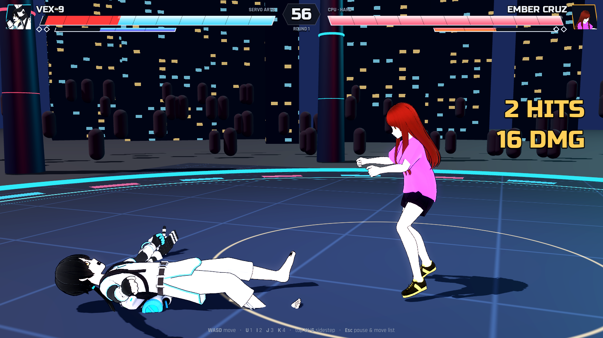
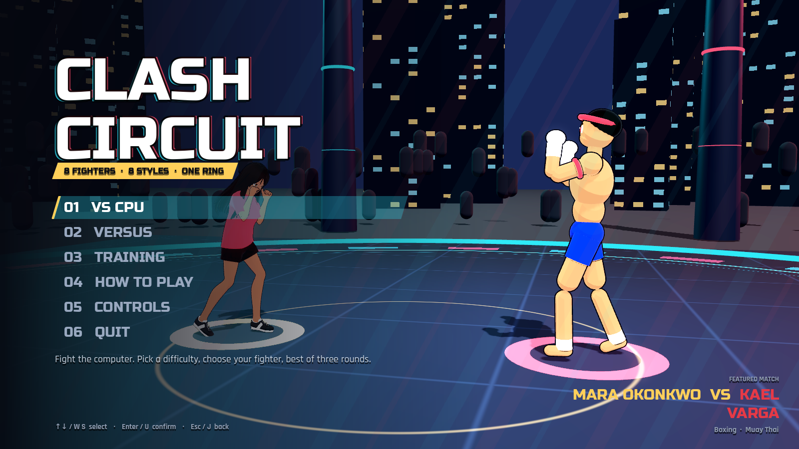
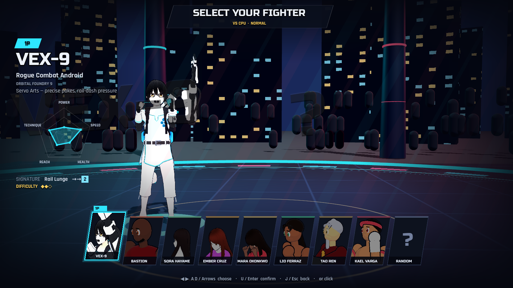
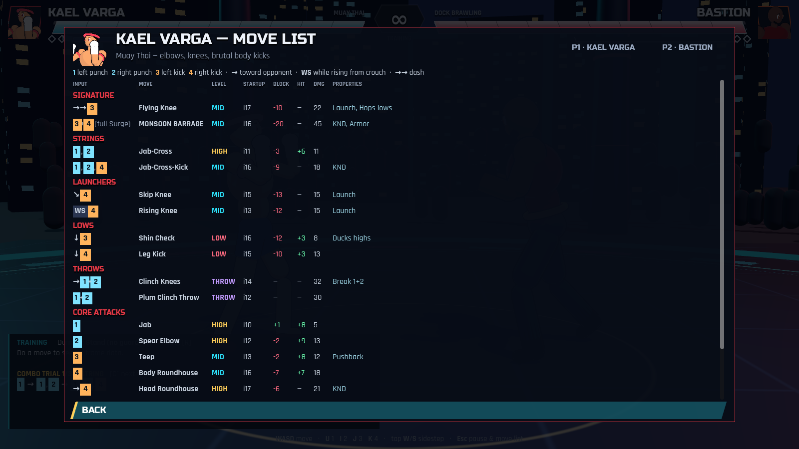

<div align="center">

# ⚡ CLASH CIRCUIT ⚡

### 8 fighters · 8 martial arts · one neon ring

**An original 3D arena fighter with anime cel-shaded fighters, real frame data, juggles, stances and throws. Built in Godot 4.**

[**▶ Play in your browser**](https://abdulwasay-bnb.github.io/clash-circuit/) · [Roster](#-the-roster) · [How it works](#-under-the-hood) · [Make your own fighter](#-bring-your-own-fighter)



</div>

---

## 🥊 What is this?

Clash Circuit is a 3D fighting game. Two fighters circle a neon arena under a city skyline and trade
strings, launchers, sidesteps and throws. Every move has real **startup / active / recovery frames**,
and the game runs a fixed **60 Hz simulation**. Training mode measures **frame advantage** live, so
you can see exactly why a punish works.

<table>
<tr>
<td width="50%"></td>
<td width="50%"></td>
</tr>
<tr>
<td align="center"><sub>Title screen with a live featured match</sub></td>
<td align="center"><sub>Character select: stat radar, signature move, slanted cards</sub></td>
</tr>
</table>

## 🎮 The roster

| | Fighter | Style | Signature |
|---|---|---|---|
| 🤖 | **VEX-9** · *Rogue Combat Android* | Servo Arts: precise pokes, rail-dash pressure | Rail Lunge `→→ 2` |
| ⚓ | **BASTION** · *Harbor Heavyweight* | Dock Brawling: slow, armored, devastating | Freight Train `→→ 2` |
| 🌬️ | **SORA HAYAME** · *Wind-Step Kickboxer* | Taekwondo: kick strings and Crane stance | Gale Crescent `→→ 4` |
| 🔥 | **EMBER CRUZ** · *Masked Luchadora* | Lucha Libre: chops, dropkicks, two command throws | Volcán Suplex `→→ 1` |
| 🥊 | **MARA OKONKWO** · *Southpaw Queen* | Boxing: fastest hands, Sway stance, hooks | Bolo Bomb `→→ 2` |
| 🌀 | **LIO FERRAZ** · *Roda Rebel* | Capoeira: spinning kicks, Handstand stance | Martelo Voador `→→ 3` |
| 🐉 | **TAO REN** · *The Last Iron Monk* | Kung Fu: chain punches, palms, iron-body charge | Iron Mountain `→→ 2` |
| ⚡ | **KAEL VARGA** · *Eight-Limbed Storm* | Muay Thai: elbows, knees, body kicks | Flying Knee `→→ 3` |

Each fighter has **17–23 unique moves** (146 in total), plus a throw and an armored **Surge Art** super.
The full lists with frame data are in-game under **Pause → Move List**.



## 🕹️ Controls

| Action | Player 1 | Player 2 | Gamepad |
|---|---|---|---|
| Move / crouch | `W A S D` | Arrow keys | D-pad / left stick |
| 1 · left punch | `U` | `Num 4` / `O` | X |
| 2 · right punch | `I` | `Num 5` / `P` | Y |
| 3 · left kick | `J` | `Num 1` / `L` | A |
| 4 · right kick | `K` | `Num 2` / `;` | B |
| Sidestep | tap `W` / `S` | tap ↑ / ↓ | tap up / down |
| Dash / backdash | `D D` / `A A` | → → / ← ← | double-tap |
| Pause & move list | `Esc` | | Start |

**Training mode:** `T` changes the dummy, `R` resets positions, `C` cycles **Combo Trials**.

## 🧠 Under the hood

- **Frame-perfect core.** A fixed 60 Hz simulation separate from rendering, with an input buffer,
  string cancel windows and buffered presses that chain into strings.
- **3D movement that matters.** Linear moves lock their direction after 2 frames, so a sidestep
  during startup makes them whiff. Homing moves keep tracking.
- **Real fighting-game systems.** High, mid and low hit levels; counter hits; armor; throw breaks;
  launchers that recover fast enough to juggle; damage scaling; ground bounces; while-standing
  attacks; stances.
- **Anime fighters.** VRM 1.0 avatars are loaded at runtime and driven by our own keyframed move
  animations. Each frame, the poses are retargeted onto the humanoid skeleton, with VRM rotation,
  roll and aim constraints applied, fists curled, and feet planted on the floor. A custom cel shader
  adds rim light and ink outlines.
- **Smooth motion.** Spring-damped joints, anticipation and follow-through keys on every attack, and
  interpolation between physics ticks.
- **CPU opponent** in three difficulties. It reads lows, sidesteps linear moves, punishes unsafe
  attacks and runs juggles.
- **Combo Trials** generated from each fighter's own move data, checked against what actually lands.

```
scripts/
  fighter.gd     state machine: strings, stances, throws, juggles, spring-smoothed posing
  main.gd        arena, camera, hit resolution, effects, synthesized audio, match flow
  vrm_rig.gd     VRM loader + retargeting + constraints + expressions
  toon_rig.gd    procedural fallback fighter (also the animation proxy)
  fighter_ai.gd  CPU opponent
  game_ui.gd     HUD, menus, select screen, VS splash, move list, training panel
data/roster.json all 8 fighters: stats, looks, poses, 146 moves with frame data
shaders/         cel shading, outlines, arena floor, skyline
```

## 🚀 Run it locally

```bash
# Godot 4.3: https://godotengine.org/download
./run.sh            # play
./run.sh --editor   # open in the Godot editor
```

**Automated checks.** These drive real inputs and need no window:

```bash
xvfb-run -a godot --path . --rendering-driver opengl3 -- --autotest=combat   # frame data, stances, throws
xvfb-run -a godot --path . --rendering-driver opengl3 -- --autotest=trials   # combo trials clear via real inputs
```

**Web build**

```bash
godot --headless --path . --export-release "Web" build/web/index.html
```

## 🎨 Bring your own fighter

Design a character in **VRoid Studio**, export it as **VRM 1.0**, and save it as
`characters/<id>/model.vrm`. The game picks it up automatically, with no code changes.
[`VROID_GUIDE.md`](VROID_GUIDE.md) has step-by-step instructions and a design brief for every fighter.

## 🗺️ Roadmap

- [x] 8 fighters, 146 moves, frame data, juggles, stances, throws
- [x] Anime VRM fighters with retargeted animation
- [x] Combo Trials, smooth animation, web build
- [ ] Custom VRoid models for the whole roster
- [ ] More stages
- [ ] Android build with touch controls
- [ ] Online versus

## 📜 Credits

Sample avatars **Seed-san** (© VirtualCast, Inc.) and **VRM1_Constraint_Twist_Sample** (© pixiv Inc.)
are used under the [VRM Public License 1.0](https://vrm.dev/licenses/1.0/). Fonts: Russo One and
Rajdhani (SIL OFL), DejaVu Sans. Engine: [Godot](https://godotengine.org) (MIT).
See [`CREDITS.md`](CREDITS.md).
